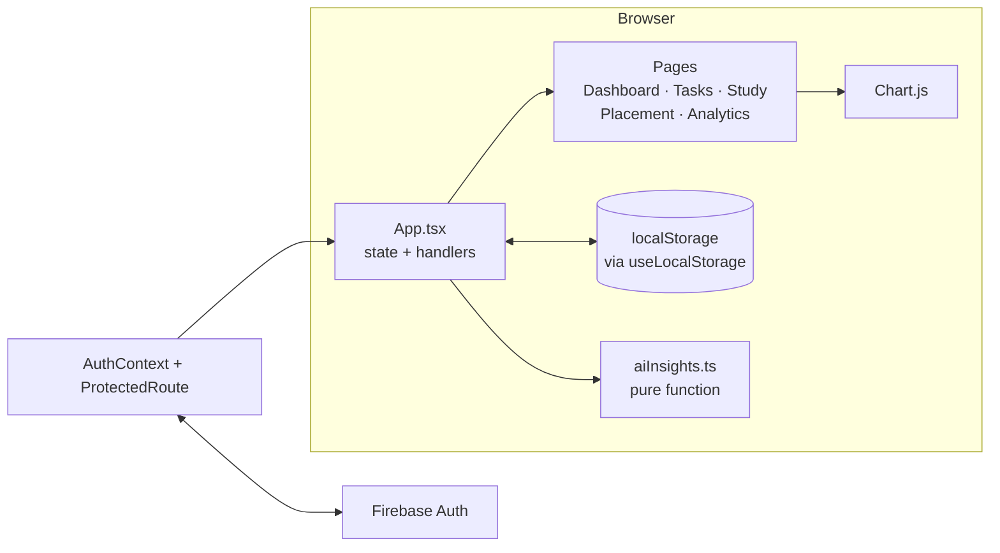

<div align="center">


<br>

<a href="https://trackify.wasmer.app"></a>


<br><br>

**[Features](#-what-it-does) · [The coach](#-how-the-ai-coach-thinks) · [Run it](#-run-it-locally) · [Architecture](#-how-its-built) · [Limits](#-known-limits)**

<br>


</div>

<br>

## 🎯 Why I built it

Placement prep has a lot of moving parts: DSA questions, study hours, a to-do list that never shrinks, and a growing pile of applications at different stages. Mine lived in four places and none of them told me the truth.

Trackify puts all of it in one dashboard, and the dashboard doesn't flatter you. If you've studied two days this week, it says so.

<div align="center">

<br>


<sub>Dashboard in the light theme, study tracker in the dark one.</sub>

</div>

<br>

## ✨ What it does

<table>
<tr>
<td width="33%" valign="top">

### 📋 Task Manager
Add tasks with a priority, filter by all, pending or completed, and tick them off. Toasts confirm adds and deletes.

</td>
<td width="33%" valign="top">

### 📚 Study Tracker
Log hours and DSA questions per day. A **streak** counts consecutive days and resets the moment you skip one.

</td>
<td width="33%" valign="top">

### 💼 Placement Tracker
Every application as a colour-coded card: **applied → interview → selected / rejected**. Update a status in place as things move.

</td>
</tr>
<tr>
<td valign="top">

### 📊 Analytics
Bar, line and doughnut charts for study hours, DSA solved, task priority split and placement outcomes.

</td>
<td valign="top">

### 🧠 AI Productivity Coach
Reads your tasks, study logs and streak, then tells you what's slipping. Strict on purpose.

</td>
<td valign="top">

### 🌗 Light and dark
Both themes run on CSS custom properties and remember your choice.

</td>
</tr>
</table>

<div align="center">

<br>


<br><sub>Task Manager: priority tags, filters, strike-through on done.</sub>

</div>

<br>

## 🧠 How the AI coach thinks

There is no model and no API key behind it. `src/utils/aiInsights.ts` is a pure function: you hand it your tasks, your study logs and your streak, and it returns three short, pointed observations. It runs in the browser, so it works offline and costs nothing.

| It looks at | And reacts when | Tone |
|---|---|---|
| **Tasks** | more than 2 high-priority pending, more than 6 pending, completion under 40%, or over 85% | blunt, then grudging praise |
| **Study** | 2 or fewer active days in the last 7, under 1.5 h/day on average, or under 5 DSA questions that week | placement-prep reality check |
| **Streak** | 0, under 5, under 21, under 60, or 60+ days | from "start again, right now" to "audit what you're actually doing" |

A real line from it:

> *Discipline isn't motivation, it's a daily decision. Start again today. Not after lunch. Not tomorrow. Right now.*

Rule-based was a deliberate choice. A strict, predictable coach is easier to trust than a chatty one, and every sentence it can say is a line I can read in one file.

<br>

## 🚀 Run it locally

You need **Node 18+**.

```bash
git clone https://github.com/SonamNarula/Trackify-college-minor-project.git
cd Trackify-college-minor-project
npm install
npm run dev        # http://localhost:5173
```

Production build:

```bash
npm run build      # type-checks with tsc, then bundles with Vite
npm run preview
```

<details>
<summary><b>Using your own Firebase project</b></summary>

<br>

Sign-in (email and password, or Google) runs on Firebase Authentication. The config in `src/firebase.ts` points at the project behind the live demo. To use your own, create a Firebase project, enable the Email/Password and Google providers, and replace the config object. Firebase web keys identify a project and aren't secrets, so the real protection is the **authorized domains** list in the Firebase console.

</details>

<br>

## 🔬 How it's built



- **One source of truth.** `App.tsx` owns tasks, study logs, placements and the streak, and passes them down with handlers. Pages stay presentational.
- **`useLocalStorage<T>`** is a small generic hook: read once on load, write on every change. Everything survives a refresh.
- **Streak logic** only moves when you log *today*: if the last logged day was yesterday it increments, if it was longer ago it restarts at 1, and logging again the same day changes nothing.
- **Auth gate.** `ProtectedRoute` renders the app only once Firebase confirms a user.

<details>
<summary><b>Data model</b></summary>

<br>

```ts
Task          { id, title, priority: 'low' | 'medium' | 'high', completed, createdAt }
StudyLog      { date: 'YYYY-MM-DD', hours, dsaQuestions }
PlacementApp  { id, company, role, status: 'applied' | 'interview' | 'rejected' | 'selected', appliedDate, notes }
```

</details>

<details>
<summary><b>Project structure</b></summary>

<br>

```
src/
  App.tsx              root state and handlers
  context/             AuthContext (Firebase)
  components/          Sidebar, Header, StatCard, Toast, EmptyState, ProtectedRoute
  pages/               Dashboard, TaskManager, StudyTracker, PlacementTracker, Analytics, Login
  hooks/               useLocalStorage
  utils/aiInsights.ts  rule-based coach
  types/               shared types
  styles/global.css    themes and layout
docs/                  synopsis, full report, code walkthrough
```

</details>

<br>

## 🚧 Known limits

Being upfront about what this is, and isn't:

- **Data lives in the browser.** It's `localStorage`, so it doesn't sync across devices, and it isn't separated per account: two logins on one browser share the same data.
- **The coach is rules, not learning.** It's consistent and explainable, but it can't notice anything its thresholds don't cover.
- **No automated tests yet.**
- **One large JS bundle.** Code-splitting the Analytics page would trim the first load.

## 🗺️ Next

- [ ] Per-account data in Firestore, so progress follows you across devices
- [ ] Tests for the streak logic and the coach rules
- [ ] Deadline reminders
- [ ] Code-split the charts

## 📄 Docs

This started as a college minor project, so it's documented like one: a synopsis, a full report (split into six parts) and a twelve-part code walkthrough, all in [`docs/`](docs).

<br>

---

<div align="center">

Built by **Sonam Narula** · [GitHub](https://github.com/SonamNarula) · [LinkedIn](https://linkedin.com/in/sonamnarula)

<sub>Built different. No BS. Pure grind mode.</sub>

</div>
